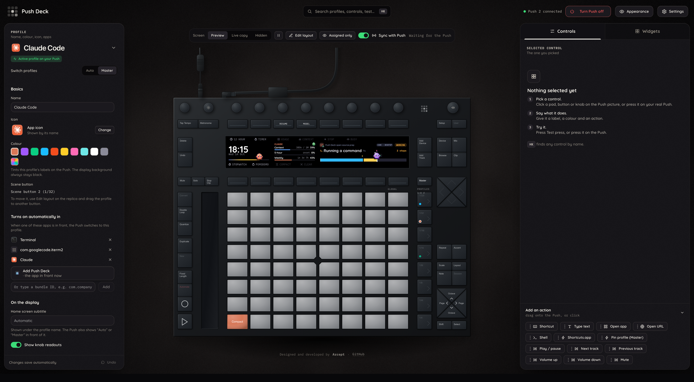
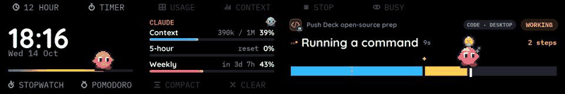
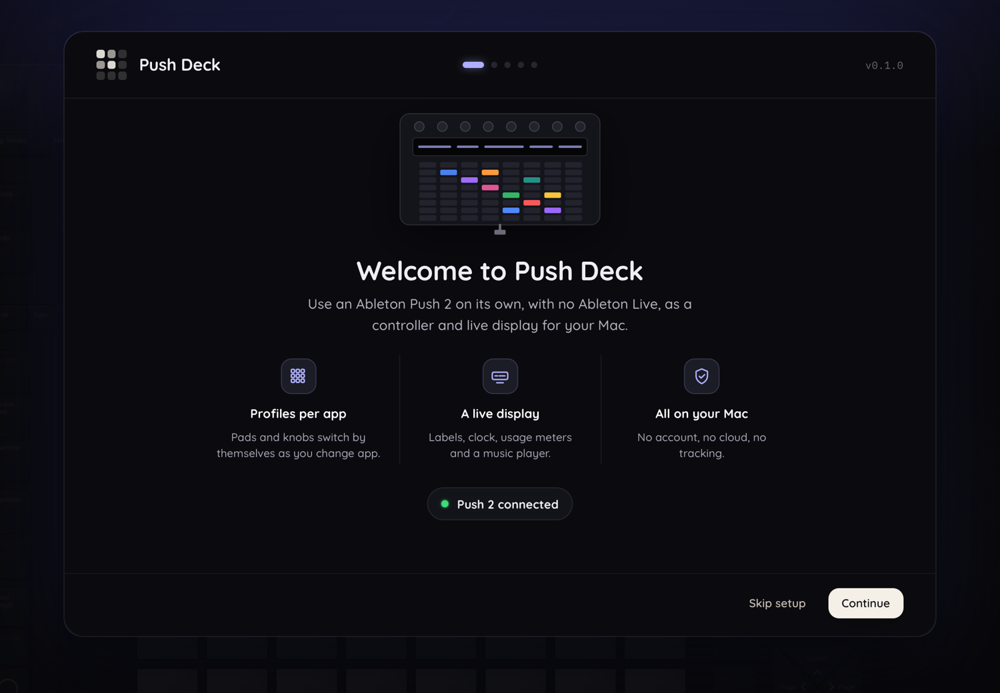
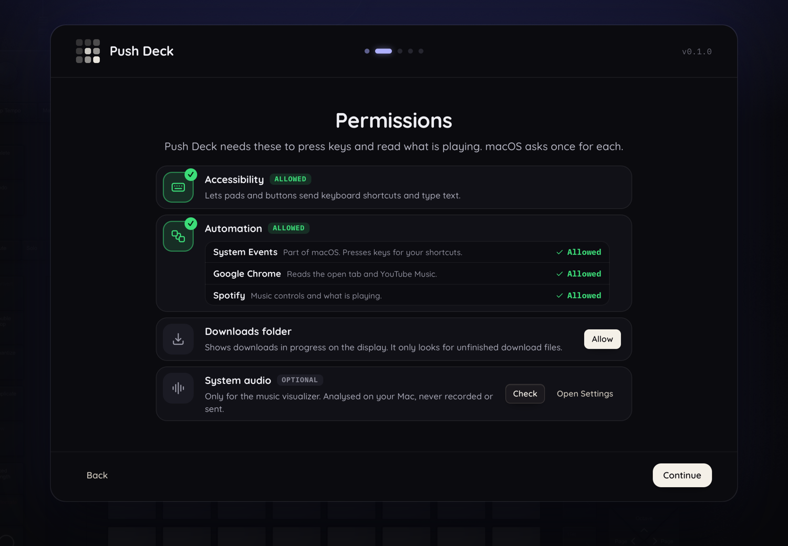
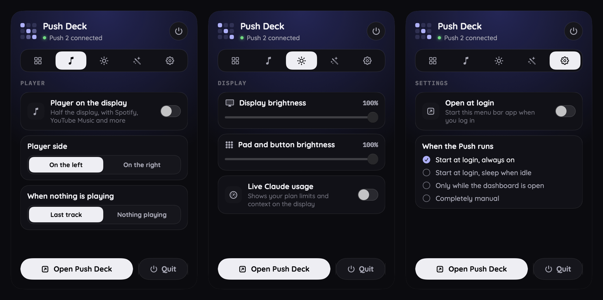

<h1 align="center">Push Deck</h1>

<p align="center">
  Use an <b>Ableton Push 2 on its own</b> (no Ableton Live) as a customisable controller and ambient display for your Mac.
</p>

<p align="center">
  
  
  
  
</p>

<p align="center">
  <a href="#what-it-does">What it does</a> ·
  <a href="#install">Install</a> ·
  <a href="#macos-permissions">Permissions</a> ·
  <a href="#using-it">Using it</a> ·
  <a href="#privacy-and-security">Privacy</a> ·
  <a href="#known-limits">Known limits</a> ·
  <a href="#development">Development</a> ·
  <a href="#contributing">Contributing</a>
</p>

<p align="center">
  
</p>

<p align="center">
  <br>
  <sub>The real Push 2 display, recorded: the Claude Code profile (a live session with its mascot and usage meters), then ChatGPT / Codex.</sub>
</p>

## What it does

- **Per-app profiles.** Pads, buttons and encoders run shortcuts, open apps and addresses, type text, or run Shortcuts and shell commands. The profile follows the app you are using, or you pin one.
- **A live display.** The 960×160 screen shows your button labels, a grid of widgets (clock, Claude and Codex usage, the browser's tab, timers) and a **media player** that works in every profile.
- **A browser-style UI** with a replica of the Push: click a pad to edit it, mirror the display, arrange widgets.
- **A menu bar app** to pin a profile, open the window and turn the Push on or off.

Everything runs on your Mac. No account, no cloud, no tracking.

> Independent project, **not affiliated with, endorsed by, or sponsored by Ableton AG**. "Ableton" and "Push" are trademarks of Ableton AG. See [NOTICE.md](NOTICE.md).

## A look around

<p align="center">
  
  
  <br><sub>First-run setup: checks your Push, explains each macOS permission, offers a short tour.</sub>
</p>

<p align="center">
  
  <br><sub>The menu bar panel: pin a profile, switch the player, set brightness, turn the Push on or off.</sub>
</p>

## Install

**You need:** an Apple Silicon Mac on macOS 13 or newer, and an **Ableton Push 2** on USB (not the original Push or Push 3). Nothing else: the app carries its own Python, libraries and helpers. The music visualizer needs macOS 14.2; the system "now playing" reader needs macOS 15.4 or newer to work as built. Chrome, Spotify and the Claude desktop app are optional; features that use them are simply off without them.

> **Releases are not out yet.** The three easy routes below switch on with the first release. Until then, [build from source](#build-from-source).

| Route | How |
| --- | --- |
| **Download** | Get the `.dmg` from [Releases](https://github.com/arcept/pushdeck/releases), drag Push Deck to Applications. |
| **Homebrew** | `brew install --cask arcept/tap/pushdeck` |
| **One line** | `curl -fsSL https://raw.githubusercontent.com/arcept/pushdeck/main/get.sh \| bash` (checks the download's checksum before installing) |

Push Deck is signed ad hoc, not with a paid Apple Developer ID, so a downloaded copy shows "unidentified developer" the first time. **Right-click the app, choose Open, then Open again**, once. The one-line route avoids this.

### Build from source

You need Python 3.9+, Node 18+, [Homebrew](https://brew.sh) (for `libusb`) and the Xcode command line tools (`xcode-select --install`).

```bash
./install.sh                # builds Push Deck.app into build/ and installs it in /Applications (asks before replacing)
```

To run only the daemon and the browser UI, without the app:

```bash
brew install libusb && python3 -m venv .venv && .venv/bin/pip install -r requirements.txt
cd ui && npm install && npm run build && cd ..
./run_daemon.sh             # then open http://127.0.0.1:8472  (another port: set PUSH_PORT)
```

Settings and profiles live in `~/Library/Application Support/Push Deck`. Settings → General has "Open at login".

### macOS permissions

The first-run setup walks you through these; macOS asks once for each.

| Permission | Needed for |
| --- | --- |
| **Accessibility** | pads and buttons that send keyboard shortcuts or text |
| **Automation** (System Events, Chrome, Spotify) | pressing keys, reading and controlling players |
| **Downloads folder** | showing downloads in progress on the display |
| **System audio** (optional) | the music visualizer; audio is analysed on your Mac, never recorded |

## Using it

**Profiles.** Click a profile, then click any pad, button or encoder on the replica and give it a name, an icon and an action. Profiles are plain JSON in `profiles/` and can be exported and imported from the UI. A profile follows its app (Auto), or press its scene button to make it Master. The Swing encoder sets display and pad brightness, and the Master encoder sets the volume (reassign in Settings → Knobs).

<details>
<summary><b>Media player</b></summary>

The **Layout** button turns the player On or Off. On, it takes half the display (left or right in Settings → Media) and your widgets use the other half.

- **Players:** Spotify, YouTube Music, and anything macOS lists as playing (Chrome video, Music, VLC, ...). It stays on the player you use until another starts.
- **Buttons:** Play, Prev, Next, Save/Like on the lower row; Shuffle, Repeat, Browse above. The touch strip seeks.
- **Browse:** the queue and your playlists on one half, the player on the other. Encoders scroll, Select opens a playlist, Favorite stars it.
- **Chrome and YouTube Music:** turn on Chrome's **View → Developer → Allow JavaScript from Apple Events**, or only the tab title can be read. YouTube Music has no official API, so queue and playlists come from your own signed-in tab and can break when YouTube changes its page.
- **Spotify (optional):** works without signing in. Signing in adds Save, the queue and playlists (no Premium needed). Create an app at <https://developer.spotify.com/dashboard>, add the redirect `http://127.0.0.1:8472/spotify/callback`, paste its Client ID into Settings → Media and press Connect. Only the Client ID is needed (PKCE). Tokens stay in `private/spotify.json` on your Mac. In Spotify's development mode, only playlists you made or share can be opened; others can still be played.
</details>

<details>
<summary><b>Claude and Codex usage</b></summary>

- **Codex** comes from its local session logs (`~/.codex/sessions`). Nothing leaves your Mac.
- **Claude, live** (Settings → General): reads the login the Claude desktop app already has (macOS asks once to unlock the "Claude Safe Storage" Keychain item) and asks `api.anthropic.com` for your usage about every 90 seconds. The token is held in memory only, never written or logged, sent nowhere else, and never refreshed by Push Deck. Off by a switch. It is the only feature that touches a login, and the first-run setup asks before using it.
- **Claude, no login:** point Claude Code's status line at `claude_statusline.py`; it writes a small local file the display reads.
</details>

## Privacy and security

- The daemon listens on `127.0.0.1` only. No analytics, no cloud service, no account of ours.
- Network traffic goes only to services you connect: Spotify (if you sign in), `api.anthropic.com` (live Claude usage, if enabled) and pages open in your own Chrome.
- Credentials you enter stay in `private/` on your Mac (git-ignored). Shell-command actions run exactly what you wrote, so only import profiles you trust.

## Known limits

- Spotify's queue shows about 20 upcoming songs; playlists load up to 500.
- YouTube Music browsing needs its tab open in Chrome.
- "Now playing" for other players uses Apple's private MediaRemote framework, which Apple can change in any macOS update.
- After using the YouTube Music app window, Chrome keeps sending media keys to it while it is in front (Chrome and macOS behaviour).

## Development

**Dev mode is the test version.** `./dev.sh` runs the daemon from this folder (its own `settings.json` and `profiles/`) and rebuilds the UI on every save, at <http://127.0.0.1:8472>. Test there, then run `./install.sh`.

```bash
./dev.sh                    # daemon + UI rebuilt on save
cd ui && npm run dev        # alternative: UI with hot reload, proxying /ws to the daemon
cd ui && npm run build      # type-check, then build ui/dist
PYTHONPATH=daemon .venv/bin/python -m push_daemon.display.tokens   # rewrite ui/src/display/tokens.json
```

The display is drawn twice on purpose: `daemon/push_daemon/display/render.py` draws what the Push shows and `ui/src/display/render.ts` draws the same scene in the browser. Change both together, and restart the daemon after any Python change.

| Path | What it is |
| --- | --- |
| `daemon/push_daemon/` | the Python daemon: USB/MIDI, profiles engine, display renderer, media, WebSocket and HTTP server |
| `daemon/audiotap/`, `daemon/nowplaying/` | small native helpers (visualizer audio tap, "what is playing" lookup), built into the release |
| `ui/` | the UI (React, Vite, TypeScript) |
| `menubar/` | the Swift menu bar app and its build script |
| `tools/` | packaging: bundled Python, `.dmg`, smoke test, dev data backup |
| `docs/` | notes: [PUSH2_NOTES.md](docs/PUSH2_NOTES.md) (verified hardware facts), [ROADMAP.md](docs/ROADMAP.md), [DESIGN.md](docs/DESIGN.md), [PRODUCT.md](docs/PRODUCT.md), [BUTTONS.md](docs/BUTTONS.md) |
| `profiles/`, `design/`, `experiments/` | starter profiles; logo, icon and fonts (SIL OFL); the original hardware experiments (not used by the app) |

## Contributing

Push Deck is young and built by one person. **Issues are open**: bug reports, ideas and hardware notes are welcome. **Pull requests are by invitation only for now**, so please open an issue first.

## Licence

[MIT](LICENSE), copyright Arcept. Fonts and other third-party pieces are credited in [NOTICE.md](NOTICE.md).

Built with AI assistance.
